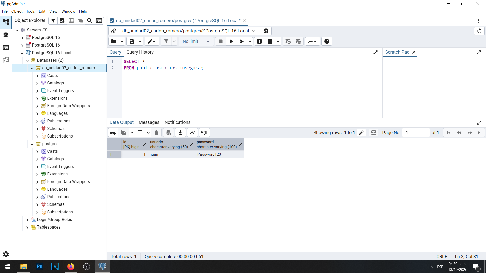
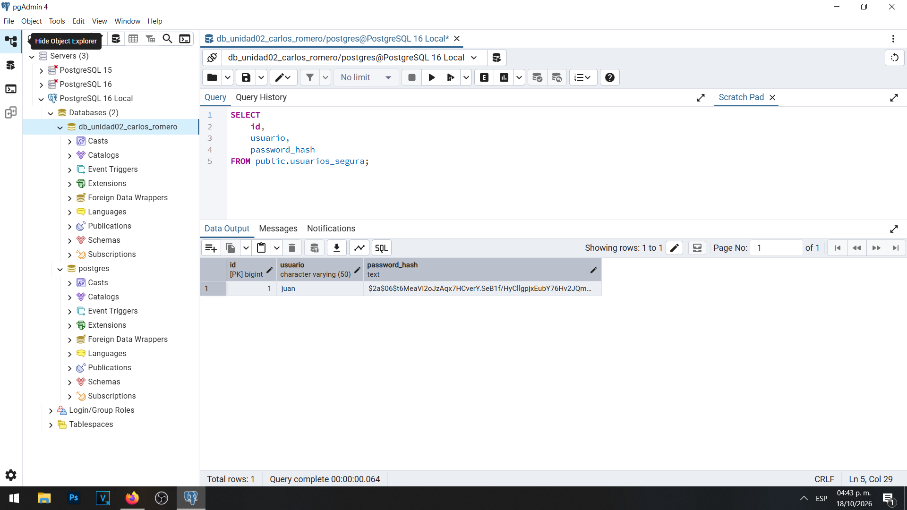
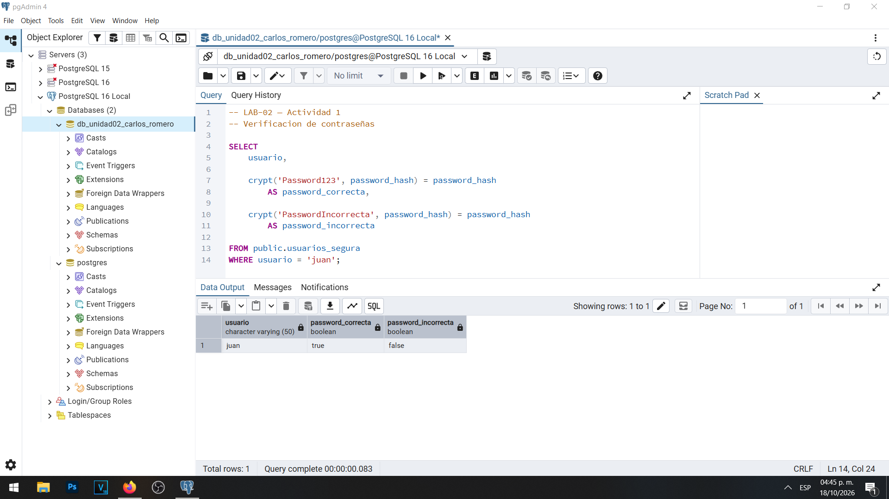
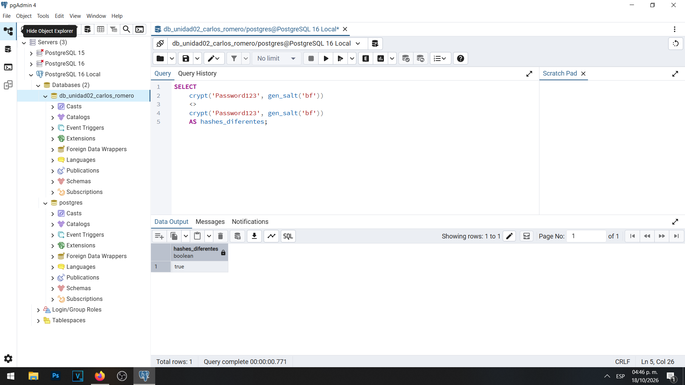

# Evidencia 01 — Protección de credenciales

## Objetivo

Demostrar los riesgos del almacenamiento de contraseñas en texto claro y aplicar un mecanismo de hash con sal para proteger las credenciales de usuarios en PostgreSQL 16.

## Procedimiento

Se instaló y verificó la extensión `pgcrypto`. Posteriormente se creó la tabla `usuarios_insegura`, que almacena una contraseña ficticia directamente, y la tabla `usuarios_segura`, que utiliza `crypt()` junto con `gen_salt('bf')`.

Se verificaron contraseñas correctas e incorrectas y se compararon dos hashes generados a partir de una misma contraseña.

El código SQL se encuentra en [01-credenciales.sql](../sql/01-credenciales.sql).

## Resultados obtenidos

**Prueba 1. Contraseña almacenada en texto claro.**

La consulta a `usuarios_insegura` permitió observar directamente la contraseña ficticia `Password123`.

**Prueba 2. Contraseña protegida mediante bcrypt.**

La tabla `usuarios_segura` mostró una representación hash en lugar de la contraseña original.

**Prueba 3. Validación de credenciales.**

La contraseña correcta produjo `true`, mientras que la contraseña incorrecta produjo `false`.

**Prueba 4. Generación de hashes diferentes.**

Al aplicar salts independientes a una misma contraseña se obtuvieron hashes distintos.

## Análisis

Una persona con acceso de lectura a una tabla de contraseñas en texto claro podría conocer inmediatamente las credenciales almacenadas.

La función `gen_salt('bf')` genera una sal para bcrypt, mientras que `crypt()` produce o verifica la representación de la contraseña. Las sales aleatorias explican por qué dos hashes de una misma contraseña pueden ser diferentes.

No es necesario recuperar la contraseña original: basta con verificar si la contraseña proporcionada coincide con el hash almacenado.

El hash de contraseñas no debe confundirse con el cifrado reversible.

## Conclusión

El almacenamiento en texto claro representa un riesgo grave. La utilización de un algoritmo especializado de hash de contraseñas con sal permite reducir este riesgo. Para aplicaciones reales se deben utilizar bibliotecas de seguridad confiables y algoritmos apropiados, como Argon2id o bcrypt.
