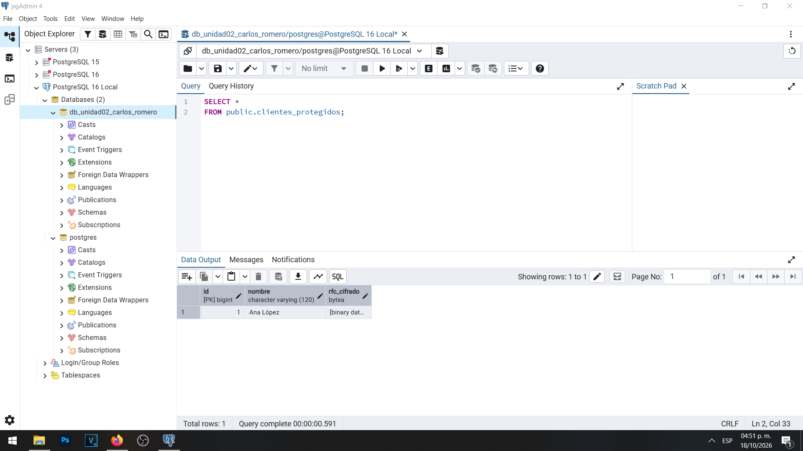
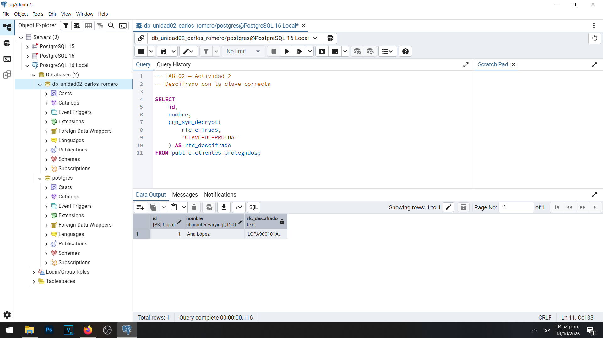
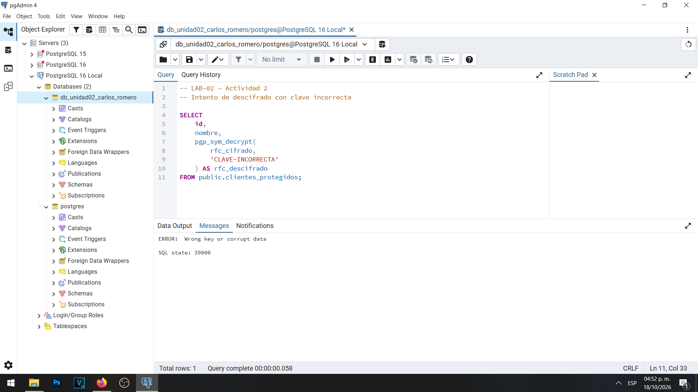

# Evidencia 02 — Cifrado de información sensible

## Objetivo

Aplicar mecanismos de cifrado simétrico en PostgreSQL 16 para proteger información sensible almacenada en una base de datos, utilizando la extensión `pgcrypto`. Asimismo, verificar el proceso de descifrado con una clave correcta y analizar el comportamiento del sistema cuando se utiliza una clave incorrecta.

## Procedimiento

Para desarrollar esta actividad se utilizó la base de datos `db_unidad02_carlos_romero` mediante pgAdmin 4.

Inicialmente se verificó la disponibilidad de la extensión `pgcrypto`, que proporciona funciones criptográficas dentro de PostgreSQL.

Posteriormente se creó la tabla `clientes_protegidos`, con una columna denominada `rfc_cifrado` de tipo `BYTEA`, destinada a almacenar información cifrada.

Se utilizó la función `pgp_sym_encrypt()` para cifrar el RFC ficticio `LOPA900101ABC`, empleando la frase demostrativa `CLAVE-DE-PRUEBA`.

Después se realizaron tres verificaciones:

1. Consultar el contenido cifrado almacenado en la tabla.
2. Recuperar el RFC original mediante `pgp_sym_decrypt()` con la frase correcta.
3. Intentar descifrar la información con una frase incorrecta para comprobar el comportamiento del mecanismo de protección.

El código SQL utilizado se encuentra en el archivo [02-cifrado-datos.sql](../sql/02-cifrado-datos.sql).

## Resultados obtenidos

### Prueba 1 — Almacenamiento del RFC cifrado

Se ejecutó una consulta sobre la tabla `clientes_protegidos` para visualizar el contenido de la columna `rfc_cifrado`.

El resultado permitió observar que el RFC no se encontraba almacenado directamente como texto legible, sino como información binaria cifrada.

Esto demuestra que la función `pgp_sym_encrypt()` transforma el contenido original antes de almacenarlo en la base de datos.

**Evidencia gráfica:**



### Prueba 2 — Descifrado del RFC con la clave correcta

Posteriormente se utilizó la función `pgp_sym_decrypt()` con la misma frase de prueba empleada durante el cifrado.

La consulta realizada fue:

```sql
SELECT
    id,
    nombre,
    pgp_sym_decrypt(
        rfc_cifrado,
        'CLAVE-DE-PRUEBA'
    ) AS rfc_descifrado
FROM public.clientes_protegidos
WHERE nombre = 'Ana López';
```

Al proporcionar la frase correcta, PostgreSQL permitió recuperar el contenido original almacenado.

El valor recuperado correspondió al RFC ficticio:

`LOPA900101ABC`

Este resultado demuestra que el cifrado simétrico es reversible cuando se dispone de la clave adecuada.

**Evidencia gráfica:**



### Prueba 3 — Intento de descifrado con una clave incorrecta

Finalmente se intentó recuperar la información utilizando una frase distinta a la empleada originalmente durante el proceso de cifrado.

La consulta utilizada fue:

```sql
SELECT
    pgp_sym_decrypt(
        rfc_cifrado,
        'CLAVE-INCORRECTA'
    )
FROM public.clientes_protegidos
WHERE nombre = 'Ana López';
```

PostgreSQL rechazó el intento de descifrado y mostró el siguiente mensaje:

`Wrong key or corrupt data`

El error correspondió al estado SQL `39000`.

Este comportamiento demuestra que una frase incorrecta no permite recuperar el contenido cifrado mediante la función utilizada.

**Evidencia gráfica:**



## Análisis de resultados

Los resultados obtenidos permiten identificar la importancia del cifrado simétrico para proteger información sensible almacenada en una base de datos.

A diferencia del hash de contraseñas, que está diseñado para verificar credenciales sin recuperar su valor original, el cifrado simétrico permite transformar información y recuperarla posteriormente mediante la clave correspondiente.

En esta actividad se comprobó que `pgp_sym_encrypt()` permite almacenar un RFC ficticio en una representación cifrada, evitando su exposición directa durante una consulta que no realiza el descifrado.

De igual manera, `pgp_sym_decrypt()` permitió recuperar el valor original cuando se utilizó la frase correcta. Al proporcionar una frase incorrecta, PostgreSQL produjo un error y no entregó el dato descifrado.

Sin embargo, el cifrado de la información no garantiza por sí solo la protección completa de los datos. También es necesario implementar controles de acceso, restringir los permisos de los usuarios y administrar adecuadamente las claves criptográficas.

Es importante señalar que la frase `CLAVE-DE-PRUEBA` se utilizó exclusivamente con fines educativos. En un sistema real, las claves no deben almacenarse directamente en archivos SQL, repositorios de código o documentación pública.

Para una implementación productiva se recomienda utilizar un gestor de secretos o un sistema de gestión de claves (KMS), acompañado de controles de acceso, rotación y procedimientos de recuperación.

## Conclusión

La actividad permitió comprobar el funcionamiento del cifrado simétrico en PostgreSQL mediante la extensión `pgcrypto`.

Se verificó que un RFC ficticio puede almacenarse cifrado, recuperarse utilizando la clave correcta y permanecer inaccesible mediante un intento de descifrado con una frase incorrecta.

Los resultados demuestran que el cifrado constituye un mecanismo importante para proteger la confidencialidad de información sensible almacenada.

No obstante, su efectividad depende de una administración segura de las claves criptográficas y de su combinación con otros mecanismos de seguridad, como los roles, permisos y controles de acceso de PostgreSQL.
