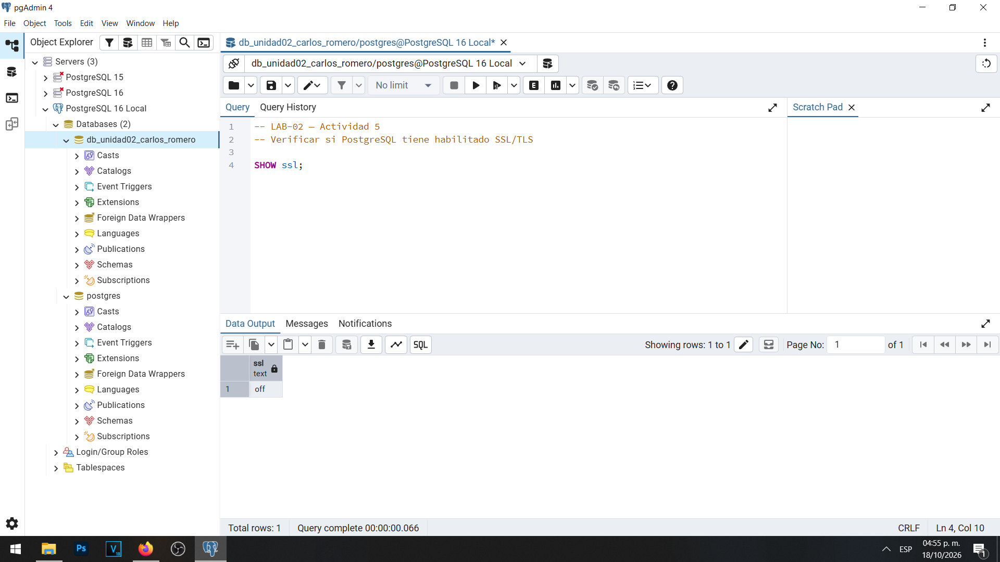
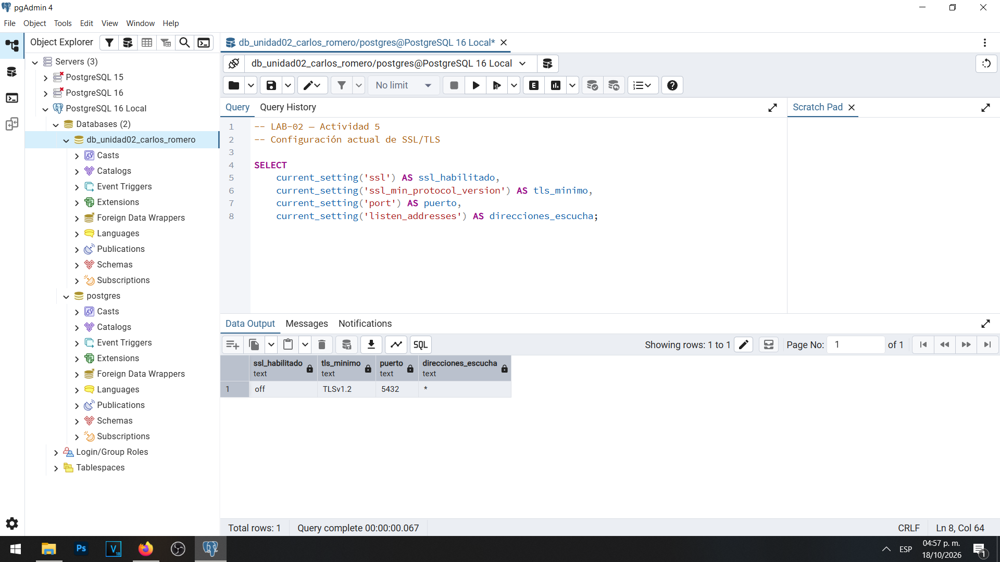
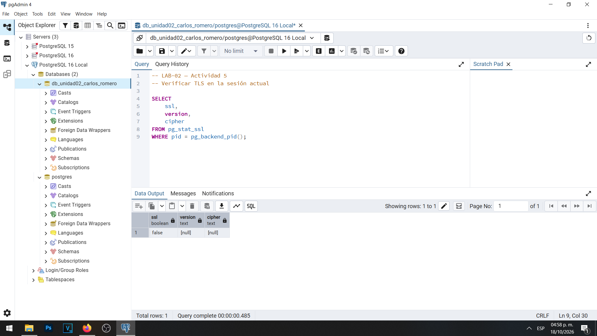
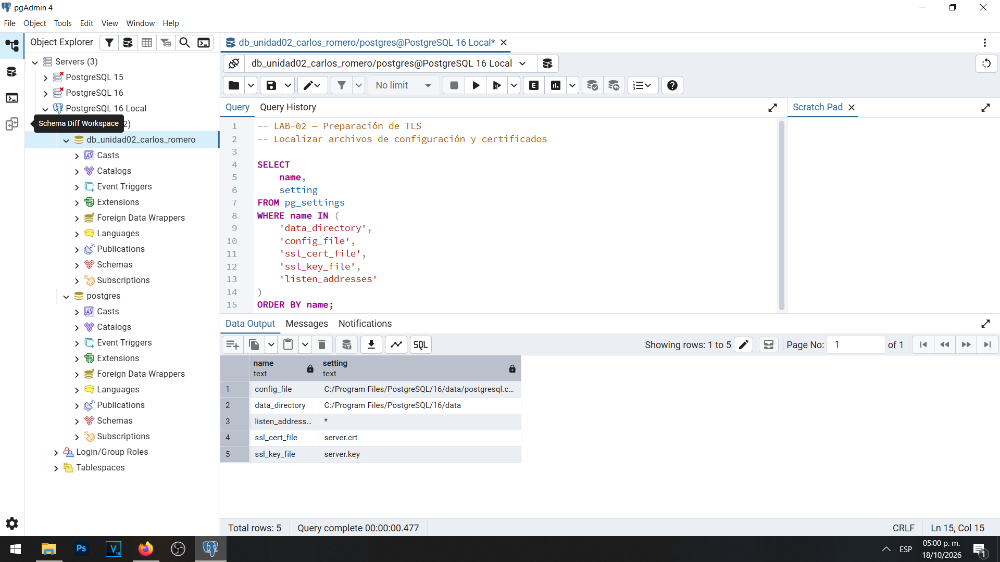
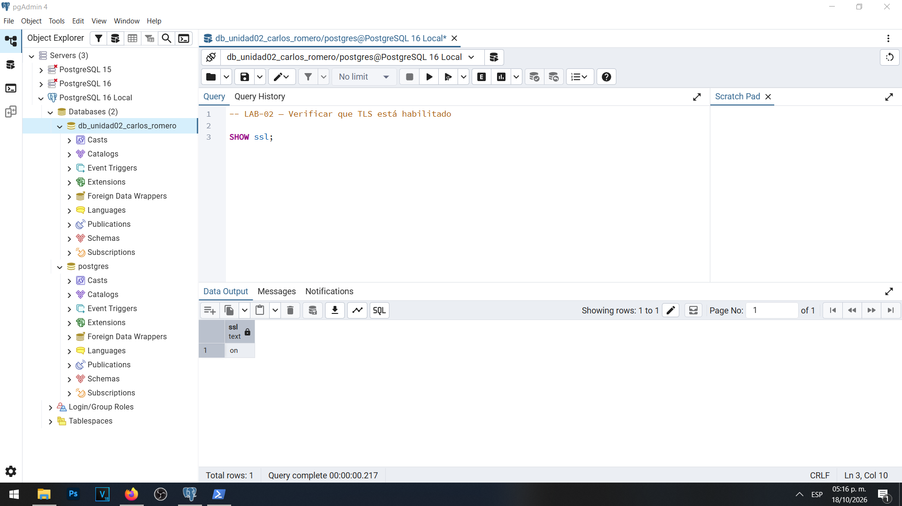
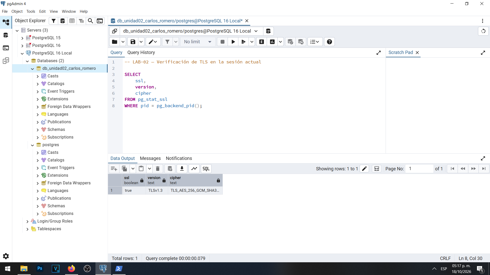
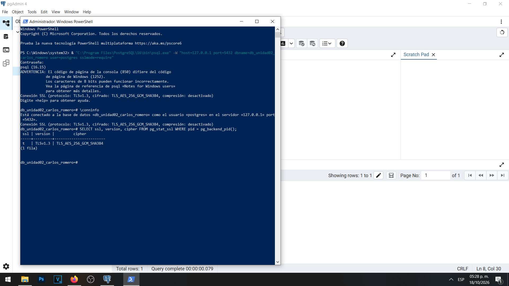

# Evidencia 04 — Comunicaciones seguras mediante TLS

## Objetivo

Configurar TLS en PostgreSQL 16 y comprobar que las conexiones desde pgAdmin 4 y psql pueden utilizar un canal de comunicación cifrado.

## Procedimiento

Se verificó inicialmente la configuración del servidor mediante `SHOW ssl;` y la vista `pg_stat_ssl`.

Posteriormente se generó un certificado autofirmado de laboratorio con OpenSSL, se protegieron los permisos del archivo de clave privada y se modificó `postgresql.conf`.

Los parámetros utilizados fueron:

```conf
ssl = on
ssl_min_protocol_version = 'TLSv1.2'
ssl_cert_file = 'server.crt'
ssl_key_file = 'server.key'
listen_addresses = 'localhost'
```

Se reinició el servicio PostgreSQL 16 y se verificó nuevamente el estado de TLS.

Finalmente se estableció una conexión mediante `psql` utilizando `sslmode=require`.

Las consultas de verificación se encuentran en [03-verificacion-tls.sql](../sql/03-verificacion-tls.sql).

## Resultados obtenidos

### Estado inicial

Inicialmente `SHOW ssl;` devolvió `off`.



La configuración inicial mostró TLS deshabilitado, versión mínima configurada `TLSv1.2`, puerto `5432` y direcciones de escucha `*`.



La vista `pg_stat_ssl` devolvió `false`, sin versión ni algoritmo negociado.



También se identificaron las rutas y nombres de los archivos de configuración utilizados por PostgreSQL.



### Estado después de la configuración

Después de reiniciar el servicio, `SHOW ssl;` devolvió `on`.



La consulta a `pg_stat_ssl` confirmó una conexión cifrada:

| Campo | Resultado |
|---|---|
| ssl | true |
| version | TLSv1.3 |
| cipher | TLS_AES_256_GCM_SHA384 |



### Verificación mediante psql

Se realizó una conexión desde PowerShell utilizando PostgreSQL 16.15 y el parámetro `sslmode=require`.

El comando `\conninfo` confirmó una conexión TLS 1.3. La consulta a `pg_stat_ssl` devolvió `t`, `TLSv1.3` y `TLS_AES_256_GCM_SHA384`.



## Análisis

TLS protege la confidencialidad e integridad de la información transmitida entre cliente y servidor.

La configuración `ssl_min_protocol_version = 'TLSv1.2'` establece la versión mínima permitida, pero no impide utilizar TLS 1.3. Durante las pruebas se negoció TLS 1.3.

El parámetro `sslmode=require` exige una conexión cifrada, pero no equivale a una validación completa de identidad. Para sistemas productivos debe utilizarse una configuración de confianza adecuada y, cuando corresponda, `sslmode=verify-full`.

El certificado autofirmado utilizado fue creado exclusivamente para este entorno local de aprendizaje. No se distribuyó su clave privada en el repositorio.

Habilitar TLS en el servidor tampoco obliga por sí solo a que todas las conexiones sean cifradas: se necesitan políticas de conexión que exijan TLS cuando así lo requiera el entorno.

## Conclusión

Se comprobó que PostgreSQL 16 puede establecer comunicaciones cifradas mediante TLS 1.3, tanto desde pgAdmin 4 como desde psql. La verificación de la sesión mediante `pg_stat_ssl` permitió confirmar el protocolo y el algoritmo negociados.
 