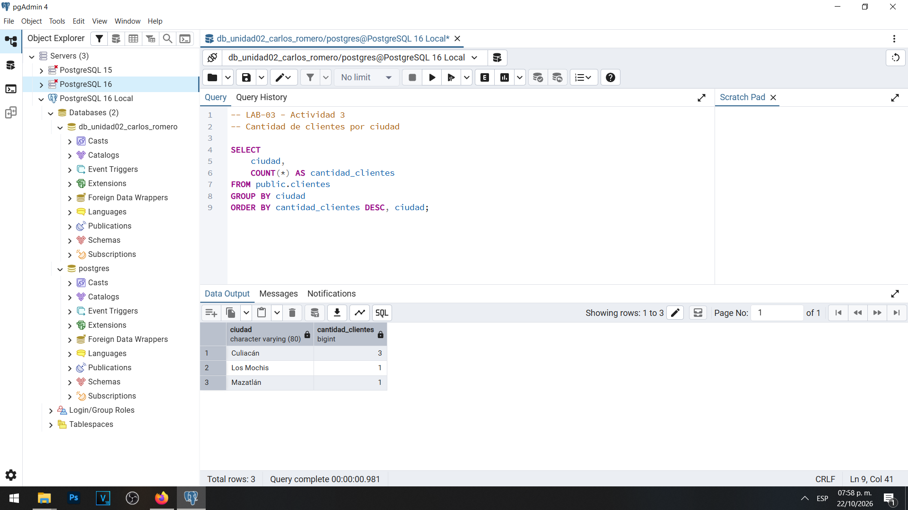
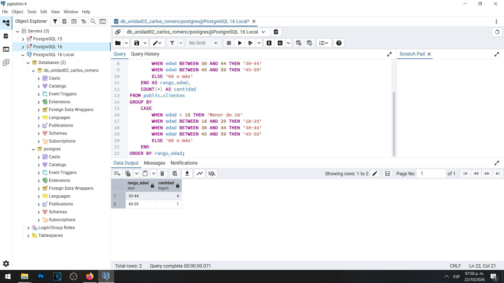
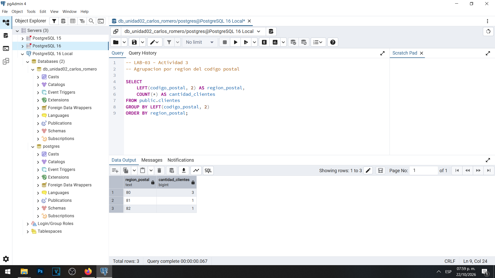
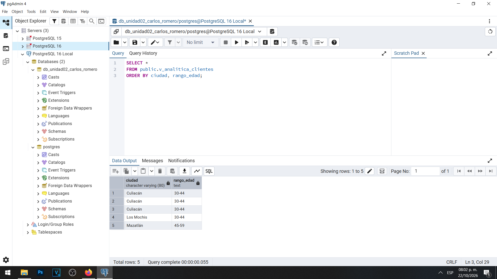
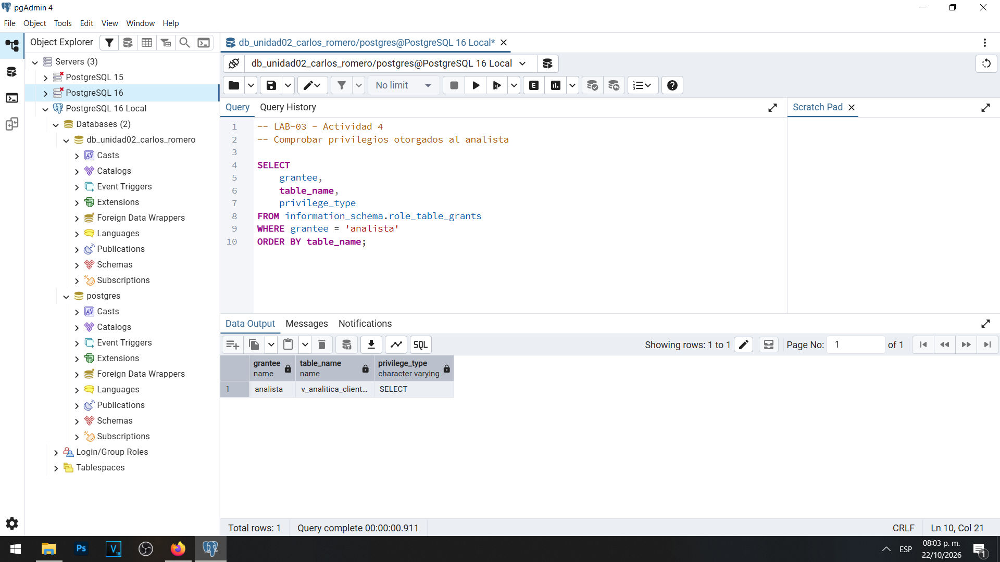
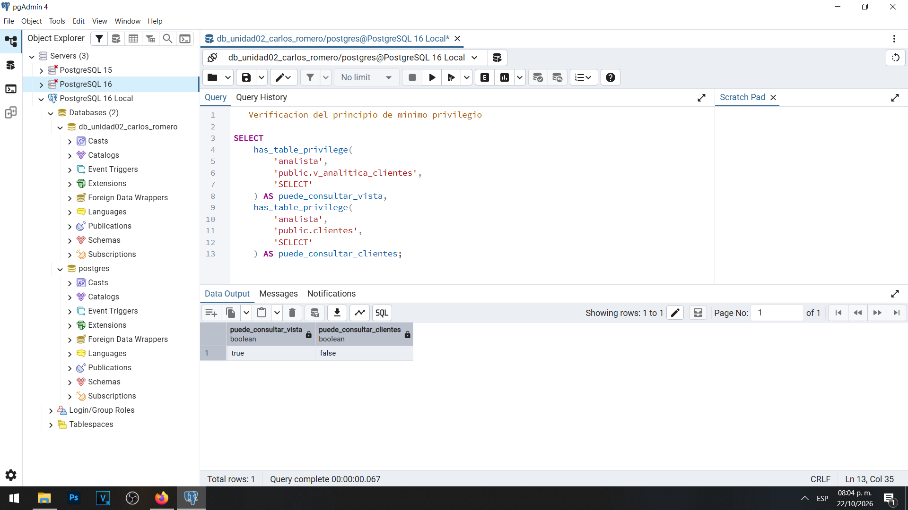
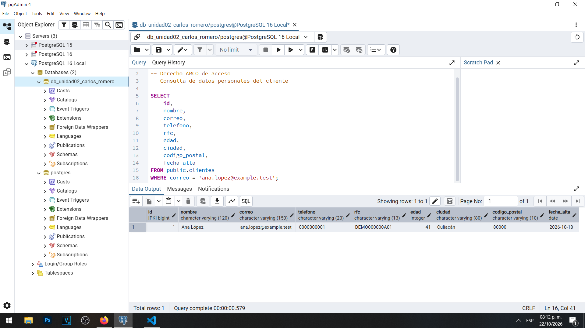
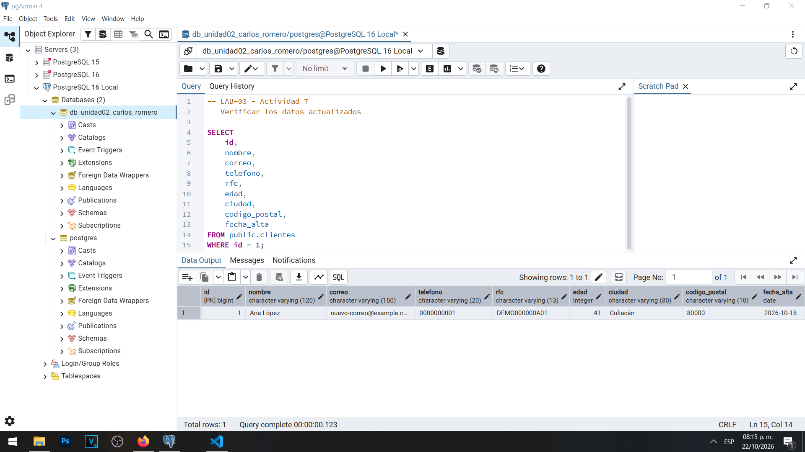
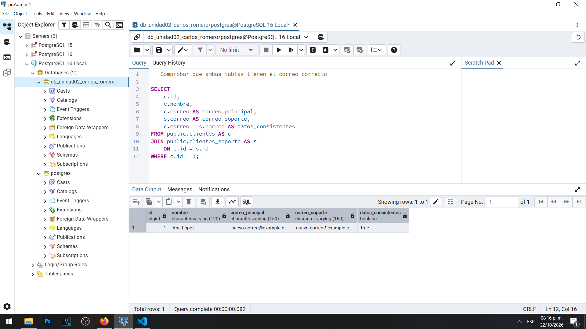

# LAB-03 — Privacidad, cumplimiento y gobierno de los datos

**Materia:** Gestión de Seguridad y Desempeño de Bases de Datos  
**Unidad:** II — Seguridad, privacidad y control de acceso  
**Tema:** Privacidad, cumplimiento normativo y gobierno de datos  
**Estudiante:** Carlos Romero  
**Motor:** PostgreSQL 16  
**Herramientas:** pgAdmin 4, PostgreSQL y Visual Studio Code  
**Base de datos:** `db_unidad02_carlos_romero`

---

## Objetivo general

Analizar y aplicar principios de privacidad, minimización, limitación de finalidad, control de acceso, retención y gobierno de datos mediante actividades prácticas y de análisis en PostgreSQL 16, identificando las implicaciones técnicas de los derechos ARCO y las responsabilidades del administrador de bases de datos.

## 1. Introducción

La protección de datos personales constituye una responsabilidad importante para las organizaciones que recopilan, almacenan y procesan información de sus clientes.

Una base de datos puede contar con contraseñas seguras, cifrado y controles de acceso, pero seguir presentando problemas de privacidad cuando almacena información innecesaria, permite usos no autorizados o conserva datos durante periodos injustificados.

Durante los laboratorios anteriores de la Unidad II se trabajaron mecanismos de clasificación, protección de información sensible, cifrado y seguridad de las comunicaciones.

En el LAB-03 se amplió este enfoque para analizar por qué se recopilan los datos, quién necesita utilizarlos, cuáles son sus finalidades y cómo deben administrarse durante todo su ciclo de vida.

Las prácticas se realizaron localmente en PostgreSQL 16 con la base de datos `db_unidad02_carlos_romero`, utilizando registros ficticios de clientes.

Se desarrollaron 15 actividades que combinan consultas SQL, control de acceso, simulaciones de derechos ARCO y análisis de políticas de privacidad y gobierno de datos.

## 2. Inventario de datos

### 2.1 Identificación de la información

Se utilizó la tabla `public.clientes`, que contiene cinco registros ficticios y nueve columnas:

| Campo | Clasificación general | Finalidad principal |
|---|---|---|
| `id` | Identificador personal indirecto | Identificación interna |
| `nombre` | Dato personal | Atención y administración |
| `correo` | Dato personal | Contacto |
| `telefono` | Dato personal | Contacto alternativo |
| `rfc` | Dato personal | Facturación |
| `edad` | Dato personal | Análisis demográfico |
| `ciudad` | Dato personal vinculado al titular | Operaciones y estadísticas |
| `codigo_postal` | Dato personal vinculado al titular | Logística y estadísticas |
| `fecha_alta` | Dato personal vinculado al registro | Control del ciclo de vida |

La clasificación permitió identificar que los campos cumplen finalidades diferentes y, por lo tanto, no deberían estar disponibles para todos los departamentos de manera indiscriminada.

**Evidencia 01 — Tabla original de clientes**

La consulta confirmó la existencia de cinco clientes con sus nueve campos originales.

La matriz completa, con justificaciones, niveles de acceso y criterios de retención, se encuentra en [01-inventario-datos.md](evidencias/01-inventario-datos.md).

## 3. Finalidades del tratamiento

Durante el laboratorio se analizaron tres finalidades principales para el tratamiento de información.

### 3.1 Atención al cliente

Esta área necesita identificar y contactar a los clientes para responder solicitudes. Puede utilizar el nombre, correo electrónico y teléfono cuando corresponda.

No requiere consultar habitualmente el RFC, la edad ni otros datos que no sean necesarios para brindar atención.

### 3.2 Facturación

El área de facturación necesita información de identificación y los datos fiscales necesarios para realizar sus operaciones.

El RFC debe contar con acceso restringido, evitando su exposición a empleados cuyas funciones no lo requieren.

### 3.3 Analítica

El área de analítica necesita generar estadísticas por ciudad, rango de edad y región postal.

Para cumplir esta finalidad no necesita acceder directamente a nombres, correos electrónicos, teléfonos o RFC.

Se realizaron tres consultas estadísticas.

**Evidencia 03 — Clientes por ciudad**

Los resultados mostraron tres clientes en Culiacán, uno en Los Mochis y uno en Mazatlán.

**Evidencia 04 — Rangos de edad**

Se identificaron cuatro clientes en el rango de 30 a 44 años y uno entre 45 y 59 años.

**Evidencia 05 — Regiones postales**

Se utilizaron los primeros dos caracteres del código postal para obtener cantidades por región.

Las consultas están documentadas en [02-finalidad.sql](sql/02-finalidad.sql).

Aunque los resultados están agrupados y no muestran identificadores directos, algunos grupos contienen una sola persona. Por ello, en sistemas reales deben considerarse medidas adicionales para reducir el riesgo de reidentificación.

### 3.4 Finalidades secundarias

También se analizó la propuesta de utilizar datos personales para promociones personalizadas.

La disponibilidad de los datos no significa que cualquier tratamiento adicional esté automáticamente autorizado.

Antes de incorporar una finalidad secundaria es necesario revisar las condiciones aplicables, la información proporcionada al titular y la necesidad de utilizar cada categoría de datos.

Este análisis se encuentra en [05-finalidad-secundaria.md](evidencias/05-finalidad-secundaria.md).

## 4. Minimización de datos

El principio de minimización establece que solamente deben tratarse los datos adecuados y necesarios para una finalidad definida.

Durante la Actividad 2 se creó la tabla `public.clientes_soporte`, utilizando cuatro columnas en lugar de las nueve existentes en la tabla original.

Los campos seleccionados fueron `id`, `nombre`, `correo` y `telefono`.

Se copiaron los cinco registros ficticios y se comprobó que la nueva tabla no contiene RFC, edad, ciudad, código postal ni fecha de alta.

**Evidencia 02 — Tabla minimizada de soporte**

| Comprobación | Tabla original | Tabla de soporte |
|---|---:|---:|
| Columnas | 9 | 4 |
| Registros | 5 | 5 |
| RFC | Sí | No |
| Edad | Sí | No |
| Código postal | Sí | No |

La creación de esta tabla demuestra que es posible conservar la información necesaria para una función específica sin reproducir toda la estructura original.

También se identificó una responsabilidad adicional: cuando existen copias de información personal en varias tablas, las rectificaciones y cancelaciones deben considerar esas copias.

El procedimiento SQL utilizado se encuentra en [01-minimizacion.sql](sql/01-minimizacion.sql).

## 5. Control de acceso

El control de acceso permite relacionar los permisos de PostgreSQL con las funciones que realmente desempeñan los usuarios.

Durante la Actividad 4 se creó el rol `analista` con la característica `NOLOGIN` y la vista `public.v_analitica_clientes`.

La vista presenta únicamente las columnas `ciudad` y `rango_edad`, evitando exponer los identificadores directos de los clientes.

**Evidencia 06 — Vista de analítica**

Posteriormente se concedió al rol `analista` permiso de uso del esquema `public` y acceso `SELECT` sobre la vista.

No se otorgó acceso directo a `public.clientes`.

**Evidencia 07 — Permisos del analista**

Para comprobar los permisos efectivos se utilizó `has_table_privilege()`.

**Evidencia 08 — Verificación de acceso restringido**

Los resultados confirmaron:

| Verificación | Resultado |
|---|---|
| Consultar `v_analitica_clientes` | `true` |
| Consultar directamente `clientes` | `false` |

Esto demuestra la aplicación del principio de mínimo privilegio y la limitación del acceso según la finalidad.

Debe señalarse que la vista utilizada muestra filas individuales con atributos generales; no constituye una solución de anonimización completa. En un sistema productivo sería conveniente incorporar vistas agregadas y restricciones adicionales cuando existan riesgos de identificación.

El procedimiento se encuentra en [03-control-acceso.sql](sql/03-control-acceso.sql).

## 6. Derechos ARCO

Los derechos ARCO comprenden acceso, rectificación, cancelación y oposición.

El DBA debe comprender sus implicaciones técnicas, pero las decisiones administrativas y jurídicas deben corresponder a las áreas responsables del tratamiento de los datos.

### 6.1 Derecho de acceso

Se simuló una solicitud de acceso relacionada con el registro ficticio de Ana López.

Se ejecutó una consulta SQL utilizando su correo electrónico para localizar la información registrada en `public.clientes`.

**Evidencia 09 — Derecho de acceso**

El resultado permitió localizar un registro con sus nueve campos.

La consulta constituye una demostración técnica. La atención formal de una solicitud requiere, además, verificar la identidad del solicitante y seguir el procedimiento institucional correspondiente.

### 6.2 Derecho de rectificación

Se simuló la corrección del correo electrónico de Ana López, identificada mediante `id = 1`.

El correo inicial `ana.lopez@example.test` fue actualizado a `nuevo-correo@example.com`.

La modificación se limitó al campo correspondiente, sin cambiar los demás datos del cliente.

**Evidencia 10 — Rectificación del correo**

Debido a que anteriormente se había creado la tabla `clientes_soporte`, también fue necesario actualizar el correo almacenado en esa estructura.

**Evidencia 11 — Consistencia entre tablas**

La verificación confirmó que ambas tablas contenían el mismo correo y que el resultado `datos_consistentes` era `true`.

Esta práctica demuestra que una rectificación debe considerar las copias de información existentes en una organización.

No se implementó una bitácora de auditoría completa ni se tramitó una solicitud ARCO real. La actividad fue una simulación técnica con datos ficticios.

### 6.3 Derecho de cancelación

Se analizó una solicitud de cancelación autorizada.

Antes de eliminar cualquier registro, el DBA debe identificar tablas relacionadas, copias, respaldos, exportaciones y otros sistemas que puedan contener la información del titular.

En nuestro entorno se identificó que `clientes_soporte` contiene una copia física de determinados datos, mientras que `v_analitica_clientes` consulta información de la tabla original.

No se ejecutaron instrucciones `DELETE` durante la actividad.

El análisis y el mapa del ciclo de vida se encuentran en [08-ciclo-vida.md](evidencias/08-ciclo-vida.md).

### 6.4 Derecho de oposición

Se analizó el caso de un cliente que solicita que sus datos no sean utilizados para promociones.

Esta solicitud no implica necesariamente que deban eliminarse todos sus registros, ya que podría existir una finalidad diferente que justifique la conservación de cierta información.

Para atenderla técnicamente podrían implementarse preferencias de privacidad, restricciones de acceso, vistas específicas y filtros que excluyan de las campañas a los titulares que hayan ejercido válidamente su derecho de oposición.

La resolución final de la solicitud debe corresponder al área responsable de privacidad.

## 7. Retención de datos

Durante la Actividad 10 se analizó la propuesta de conservar indefinidamente los datos personales porque podrían resultar útiles en el futuro.

Se concluyó que la conservación debe relacionarse con una finalidad documentada y con las obligaciones aplicables, en lugar de depender de una posible utilidad indefinida.

Una política de retención debe definir:

- Categorías de información y finalidades.
- Responsables de cada tratamiento.
- Criterios y periodos de conservación.
- Obligaciones legales aplicables.
- Procedimientos de bloqueo o eliminación.
- Controles sobre respaldos y copias.
- Mecanismos de revisión y trazabilidad.

En PostgreSQL, la columna `fecha_alta` puede apoyar la administración del ciclo de vida, pero por sí sola no determina cuándo deben eliminarse los datos.

Los periodos concretos deben ser definidos por las áreas responsables con la asesoría correspondiente.

El análisis completo se encuentra en [10-retencion.md](evidencias/10-retencion.md).

## 8. Gobierno de datos

El gobierno de datos permite establecer responsabilidades para administrar la información durante todo su ciclo de vida.

Durante la Actividad 11 se elaboró una matriz que relaciona cada campo con su finalidad, responsable, usuarios autorizados, mecanismos de protección, criterios de retención y acciones al finalizar su uso.

### Matriz resumida de responsabilidades

| Información | Responsable funcional | Acceso recomendado | Protección principal |
|---|---|---|---|
| Nombre | Atención al cliente | Soporte y facturación autorizados | Permisos y minimización |
| Correo | Atención al cliente | Personal autorizado | Acceso limitado y rectificación controlada |
| Teléfono | Atención al cliente | Soporte autorizado | Minimización y permisos |
| RFC | Facturación | Personal fiscal autorizado | Acceso restringido y cifrado cuando corresponda |
| Edad | Analítica | Analistas con datos generalizados | Rangos y agregación |
| Ciudad | Analítica y operaciones | Usuarios autorizados | Vistas y minimización |
| Código postal | Operaciones y logística | Personal autorizado | Generalización y acceso limitado |

Estos controles son propuestas de gobierno de datos, salvo aquellos que fueron efectivamente implementados y verificados durante la práctica.

La matriz completa se encuentra en [11-gobierno-datos.md](evidencias/11-gobierno-datos.md).

### Privacidad por diseño

También se analizó una aplicación que pretendía recopilar información excesiva de sus clientes.

Se identificó que campos como salario, ocupación y estado civil no deberían solicitarse para un registro básico si no existe una finalidad justificada.

Se propuso una estructura mínima y la aplicación de privacidad por defecto.

El análisis se encuentra en [12-privacidad-diseno.md](evidencias/12-privacidad-diseno.md).

### Controles técnicos y administrativos

Durante la Actividad 13 se identificaron las diferencias entre políticas organizacionales y controles implementados tecnológicamente.

| Medida | Tipo principal |
|---|---|
| Roles y permisos de PostgreSQL | Técnico |
| Política de retención | Administrativo |
| Cifrado de datos | Técnico |
| Procedimiento para solicitudes ARCO | Administrativo |
| Vista con información limitada | Técnico |
| Clasificación de información | Administrativo |
| Registro de auditoría | Técnico y administrativo |
| Política de control de acceso | Administrativo |

Los mecanismos técnicos permiten aplicar determinadas restricciones, mientras que las políticas y procedimientos establecen las responsabilidades y reglas que deben seguirse.

Ambos tipos de control son necesarios para lograr una administración adecuada de datos personales.

## 9. Evaluación integral

Durante la Actividad 14 se analizó un escenario de una empresa ficticia con 50,000 clientes.

Se identificaron riesgos relacionados con accesos excesivos, conservación prolongada, falta de documentación, copias de datos reales en desarrollo y utilización de correos electrónicos para finalidades secundarias.

Se elaboró una matriz con 13 problemas y sus controles propuestos.

### Principales riesgos identificados

| Riesgo | Control recomendado |
|---|---|
| Acceso directo de analistas a información personal completa | Vistas limitadas y revocación de accesos innecesarios |
| Exposición de RFC y datos de contacto | Restricción por finalidad |
| Conservación de información sin una política documentada | Política de retención |
| Copias reales utilizadas en desarrollo | Datos sintéticos o adecuadamente anonimizados |
| Uso de correos para campañas sin finalidad documentada | Revisión de la finalidad y mecanismos de oposición |
| Falta de responsabilidades claras | Matriz de gobierno de datos |
| Estadísticas con posibles grupos identificables | Agregación y medidas contra reidentificación |

La evaluación completa se encuentra en [14-evaluacion-integral.md](evidencias/14-evaluacion-integral.md).

### Propuesta de arquitectura protegida

Finalmente, durante la Actividad 15 se diseñó una arquitectura conceptual que separa tres componentes:

**Operación:** información necesaria para soporte y facturación.

**Analítica:** información agregada y limitada para obtener estadísticas.

**Auditoría:** registros y controles destinados a la trazabilidad de accesos, modificaciones y procedimientos relacionados con los datos personales.

La arquitectura incorpora propuestas de control de acceso, minimización, protección de información sensible, retención, eliminación controlada y atención de derechos ARCO.

No se implementó físicamente toda esta arquitectura. El diseño conceptual y la distinción entre controles implementados y propuestos se encuentran en [15-arquitectura.md](evidencias/15-arquitectura.md).

## 10. Conclusiones

El LAB-03 permitió comprender que la privacidad y la seguridad de la información están relacionadas, pero no representan exactamente lo mismo.

La seguridad proporciona mecanismos para proteger los datos contra accesos y operaciones no autorizadas. La privacidad también requiere justificar su recopilación, determinar sus finalidades, limitar su utilización y administrar correctamente su ciclo de vida.

Durante las prácticas se aplicaron mecanismos de minimización, separación por finalidad y control de acceso en PostgreSQL 16.

También se simularon técnicamente los derechos de acceso y rectificación, comprobando la importancia de mantener la consistencia entre diferentes estructuras de datos.

Las actividades de cancelación, oposición, retención y gobierno de datos permitieron identificar que el DBA no debe decidir por sí solo todas las condiciones del tratamiento.

Las políticas deben establecerse mediante la coordinación entre las áreas técnicas, de privacidad, jurídicas y administrativas.

La principal enseñanza del laboratorio es que **proteger técnicamente un dato no elimina la necesidad de justificar por qué se conserva, quién debe utilizarlo y durante cuánto tiempo**.

---

## 11. Preguntas de reflexión

### 1. ¿Basta con implementar seguridad técnica para garantizar el cumplimiento de privacidad?

No. Una base de datos puede tener contraseñas seguras, permisos restringidos y cifrado, pero todavía incumplir principios de privacidad si recopila información innecesaria o la utiliza para finalidades no justificadas.

La privacidad requiere considerar el tratamiento completo de la información, además de los controles técnicos.

### 2. ¿Cómo contribuye el mínimo privilegio a proteger la privacidad?

El mínimo privilegio limita el acceso de los usuarios a la información que necesitan para cumplir sus funciones.

En nuestro laboratorio, el rol `analista` puede consultar la vista autorizada sin tener acceso directo a `clientes`. Esto reduce la exposición innecesaria de datos personales.

### 3. ¿Por qué las finalidades del tratamiento no deben ser establecidas exclusivamente por el DBA?

Porque determinar las finalidades requiere decisiones organizacionales y, cuando corresponda, jurídicas.

El DBA puede explicar qué información almacena la base de datos e implementar restricciones, pero las áreas responsables deben establecer y autorizar los propósitos del tratamiento.

### 4. ¿Qué problemas existen al entregar automáticamente bases productivas completas a los desarrolladores?

Los desarrolladores podrían recibir información personal que no necesitan para realizar sus pruebas.

Esto incrementa el número de personas y sistemas que tienen acceso a datos reales, ampliando los riesgos de exposición, copia o utilización indebida.

Se recomienda utilizar datos ficticios, sintéticos o adecuadamente anonimizados.

### 5. ¿Qué riesgos presentan las copias de bases de datos utilizadas para desarrollo?

Pueden conservar datos reales fuera de los controles del entorno productivo.

Si esas copias se almacenan en equipos personales, servidores de prueba o respaldos sin controles suficientes, pueden generar nuevas oportunidades de exposición.

Por eso también deben formar parte del inventario y las políticas de protección.

### 6. ¿Qué importancia tiene la retención dentro del ciclo de vida de los datos?

La retención permite definir cuánto tiempo debe conservarse la información y qué ocurre cuando termina su finalidad.

Sin una política documentada, la organización podría acumular datos innecesarios, dificultar la atención de solicitudes y aumentar el impacto de una filtración.

### 7. ¿Cómo se relaciona la privacidad por diseño con las estructuras de una base de datos?

La privacidad por diseño exige considerar la protección de información desde la etapa de análisis y desarrollo.

En una base de datos, esto implica seleccionar los campos necesarios, definir finalidades, separar funciones, establecer permisos y preparar mecanismos de retención y eliminación.

La tabla `clientes_soporte` constituye un ejemplo práctico de minimización.

### 8. ¿Qué medidas técnicas aplicarías para disminuir la exposición de información personal?

Implementaría roles con mínimo privilegio, vistas restringidas, cifrado de datos sensibles cuando corresponda, TLS para comunicaciones, registros de auditoría y protección de respaldos.

También utilizaría información agregada o generalizada para analítica y mecanismos controlados para la rectificación o eliminación de datos.

### 9. ¿Qué debe conocer el DBA para atender la parte técnica de una solicitud ARCO?

Debe identificar dónde se almacenan los datos del titular, qué tablas y aplicaciones los utilizan, si existen copias o respaldos, cuáles son las dependencias y qué operaciones pueden realizarse de forma segura.

También debe conocer las restricciones técnicas y los mecanismos de verificación y auditoría disponibles.

La autorización y respuesta formal de la solicitud corresponden al área responsable.

### 10. ¿Cómo deberían distribuirse las responsabilidades entre DBA, privacidad, jurídico y propietario de los datos?

**DBA:** implementar y verificar controles técnicos, administrar permisos, estructuras, respaldos y mecanismos de trazabilidad.

**Responsable de privacidad:** coordinar las políticas de tratamiento, supervisar finalidades y gestionar las solicitudes de los titulares.

**Área jurídica:** interpretar las obligaciones aplicables y asesorar sobre las condiciones legales del tratamiento.

**Propietario o responsable funcional de los datos:** justificar las necesidades operativas, definir quién requiere la información y participar en la aprobación de reglas de acceso y conservación.

La coordinación de estas responsabilidades permite relacionar las decisiones organizacionales con mecanismos técnicos adecuados.

---

## 12. Resultados y evidencias del laboratorio

### 12.1 Resumen de actividades

| Actividad | Trabajo realizado | Evidencia principal |
|---|---|---|
| 1. Inventario | Clasificación de nueve campos | `01-inventario-datos.md` |
| 2. Minimización | Creación de `clientes_soporte` | Captura 02 |
| 3. Separación por finalidad | Estadísticas por ciudad, edad y región postal | Capturas 03–05 |
| 4. Control de acceso | Rol `analista`, vista y privilegios | Capturas 06–08 |
| 5. Finalidad secundaria | Análisis del uso promocional | `05-finalidad-secundaria.md` |
| 6. Derecho de acceso | Consulta de un titular ficticio | Captura 09 |
| 7. Rectificación | Corrección y sincronización de correo | Capturas 10–11 |
| 8. Cancelación | Análisis del ciclo de vida | `08-ciclo-vida.md` |
| 9. Oposición | Análisis de restricción de finalidades | README |
| 10. Retención | Política y criterios de conservación | `10-retencion.md` |
| 11. Gobierno | Matriz de responsabilidades | `11-gobierno-datos.md` |
| 12. Privacidad por diseño | Propuesta de estructura mínima | `12-privacidad-diseno.md` |
| 13. Controles | Clasificación técnica y administrativa | README |
| 14. Evaluación integral | Identificación de 13 riesgos | `14-evaluacion-integral.md` |
| 15. Arquitectura | Separación conceptual de datos | `15-arquitectura.md` |

### 12.2 Scripts SQL

- [01 — Minimización](sql/01-minimizacion.sql)
- [02 — Separación por finalidad](sql/02-finalidad.sql)
- [03 — Control de acceso](sql/03-control-acceso.sql)

### 12.3 Archivos Markdown de evidencias

- [01 — Inventario de datos](evidencias/01-inventario-datos.md)
- [05 — Finalidad secundaria](evidencias/05-finalidad-secundaria.md)
- [08 — Ciclo de vida](evidencias/08-ciclo-vida.md)
- [10 — Retención](evidencias/10-retencion.md)
- [11 — Gobierno de datos](evidencias/11-gobierno-datos.md)
- [12 — Privacidad por diseño](evidencias/12-privacidad-diseño.md)
- [14 — Evaluación integral](evidencias/14-evaluacion-integral.md)
- [15 — Arquitectura protegida](evidencias/15-arquitectura.md)

Las once capturas originales de pgAdmin 4 se encuentran en `evidencias/imagenes/` y están integradas en las secciones correspondientes de este informe.

## 13. Alcance y consideraciones

Las actividades se realizaron en un entorno de PostgreSQL 16 instalado localmente en Windows, utilizando información ficticia con fines académicos.

Los controles efectivamente implementados incluyen la tabla minimizada de soporte, la vista de analítica, el rol `analista`, los permisos correspondientes y la actualización controlada de un correo electrónico.

Las políticas de retención, los procedimientos formales de atención de derechos ARCO y la arquitectura completa de auditoría se desarrollaron como propuestas conceptuales.

No se ejecutaron operaciones de eliminación definitiva sobre la tabla principal durante el LAB-03.

Tampoco se implementó un sistema integral de auditoría ni se realizaron trámites legales reales de protección de datos.

Estos límites permiten distinguir los resultados técnicos obtenidos de las recomendaciones para un posible entorno productivo.
