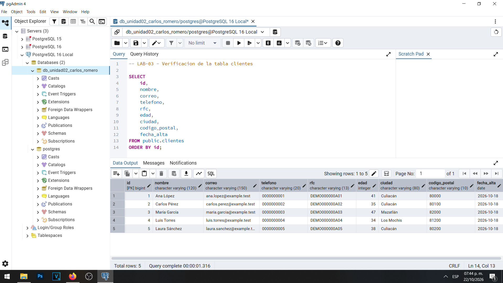
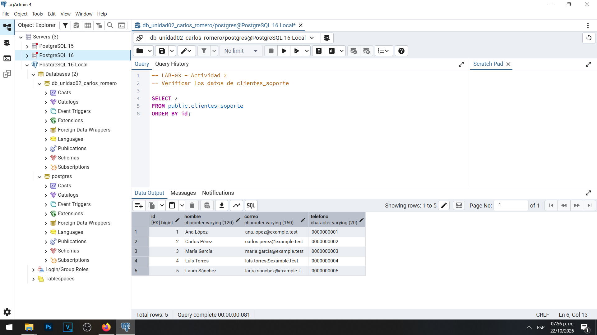

# LAB-03 — Actividad 1: Inventario y finalidad de los datos

## Objetivo

Identificar y clasificar los datos personales almacenados en la tabla `public.clientes` de PostgreSQL 16, determinando su finalidad, necesidad, nivel de acceso y criterios de retención para aplicar los principios de privacidad, minimización y gobierno de datos.

## Procedimiento

Para realizar esta actividad se utilizó PostgreSQL 16 mediante pgAdmin 4, trabajando con la base de datos `db_unidad02_carlos_romero`.

Se consultó la tabla `public.clientes`, creada previamente durante las prácticas de la Unidad II.

La consulta utilizada fue:

```sql
SELECT
    id,
    nombre,
    correo,
    telefono,
    rfc,
    edad,
    ciudad,
    codigo_postal,
    fecha_alta
FROM public.clientes
ORDER BY id;
```

La consulta permitió identificar nueve columnas y cinco registros ficticios.

Se analizaron los campos considerando su relación con las funciones de atención al cliente, facturación y analítica.

## Resultado obtenido

### Evidencia de la tabla original

La tabla `public.clientes` contiene nueve columnas destinadas a almacenar información de identificación, contacto, facturación y características generales de los clientes.



El conteo realizado en PostgreSQL confirmó la existencia de cinco registros.

### Matriz de inventario de datos

| Campo | ¿Es dato personal? | Finalidad | ¿Es necesario? | Nivel de acceso propuesto | Retención |
|---|---|---|---|---|---|
| `id` | Sí, identificador indirecto | Identificar y relacionar registros | Sí, para la gestión interna | Aplicaciones y personal autorizado | Mientras sea necesario para administrar y relacionar registros |
| `nombre` | Sí | Identificación y atención al cliente | Sí, según el proceso | Soporte y facturación autorizados | Mientras exista una finalidad operativa o una obligación aplicable |
| `correo` | Sí | Contacto y atención de solicitudes | Sí, cuando sea el canal utilizado | Soporte y personal autorizado | Mientras sea necesario para las comunicaciones autorizadas |
| `telefono` | Sí | Contacto alternativo | Condicional | Soporte autorizado | Mientras exista la necesidad justificada de contacto |
| `rfc` | Sí | Identificación fiscal y facturación | Condicional a la finalidad fiscal | Facturación autorizada | Conforme a las obligaciones fiscales aplicables |
| `edad` | Sí, vinculada al titular | Estadísticas demográficas | No para soporte; condicional para analítica | Analítica mediante rangos o agregaciones | Evitar conservar el valor individual sin justificación |
| `ciudad` | Sí, vinculada al titular | Estadísticas regionales y operaciones | Condicional | Analítica limitada y operaciones autorizadas | Mientras exista una finalidad documentada |
| `codigo_postal` | Sí, vinculado al titular | Logística y análisis regional | Condicional | Operaciones autorizadas; analítica con datos generalizados | Mientras resulte necesario para la finalidad |
| `fecha_alta` | Sí, vinculada al registro | Control del ciclo de vida del cliente | Sí, para seguimiento y gestión | Administración autorizada | Conforme a las necesidades de gestión y políticas de conservación |

**Nota:** Los criterios de conservación son propuestas académicas. La organización deberá establecer periodos concretos según las finalidades y obligaciones aplicables.

## Justificación de la clasificación

### Identificador interno

El campo `id` permite identificar cada registro dentro del sistema. Aunque no contiene directamente un nombre, puede relacionarse con una persona mediante otras tablas, por lo que debe tratarse como un identificador personal indirecto.

### Nombre

El nombre permite reconocer al cliente durante la atención y otros procesos administrativos. Debe limitarse su consulta a las áreas que realmente necesiten identificarlo.

### Correo electrónico

El correo permite comunicarse con el titular y responder solicitudes. Su utilización para promociones o finalidades secundarias requiere una justificación y condiciones de tratamiento apropiadas.

### Teléfono

El teléfono constituye un medio alternativo de contacto. No debe recopilarse obligatoriamente cuando la finalidad pueda cumplirse adecuadamente utilizando otro canal.

### RFC

El RFC se relaciona con procesos fiscales y de facturación. No debería estar disponible para usuarios cuya función no requiere información fiscal.

### Edad

La edad puede utilizarse para obtener estadísticas. Sin embargo, cuando sea suficiente conocer un rango, no es necesario proporcionar el valor individual.

### Ciudad

La ciudad puede resultar útil para análisis regionales o determinados procesos operativos. Su tratamiento debe relacionarse con una finalidad documentada.

### Código postal

El código postal puede utilizarse en actividades logísticas. Para estadísticas generales puede ser suficiente utilizar una región postal en lugar del código completo.

### Fecha de alta

La fecha de alta permite identificar cuándo comenzó la relación con el cliente y puede apoyar la administración del ciclo de vida de la información.

No obstante, esta fecha por sí sola no determina automáticamente cuándo deben eliminarse los datos.

## Relación con el principio de minimización

El inventario permitió identificar que no todas las áreas necesitan consultar los nueve campos originales.

Por ejemplo, atención al cliente requiere principalmente datos de identificación y contacto, mientras que analítica necesita información estadística.

Durante la Actividad 2 se creó la tabla `clientes_soporte`, que contiene únicamente cuatro campos:

- `id`
- `nombre`
- `correo`
- `telefono`

Esta estructura evita copiar información que no es necesaria para la finalidad de atención.



Se comprobó que la tabla de soporte contiene cinco registros, pero únicamente cuatro columnas frente a las nueve de la tabla original.

## Análisis de resultados

La clasificación demuestra que los datos almacenados en una misma tabla pueden tener finalidades y necesidades de protección diferentes.

No resulta apropiado otorgar acceso a toda la tabla simplemente porque un empleado necesita consultar uno o dos de sus campos.

El inventario facilita identificar qué información requiere cada área y ayuda a diseñar vistas, roles y permisos relacionados con las funciones del personal.

Además, permite establecer criterios de conservación, identificar datos innecesarios y preparar procedimientos para la atención de solicitudes relacionadas con derechos ARCO.

En el laboratorio se comprobó que la minimización puede aplicarse mediante una tabla derivada que contiene solamente información necesaria para soporte.

Sin embargo, la creación de una tabla adicional también implica la responsabilidad de mantener sus datos actualizados y gestionar adecuadamente su ciclo de vida.

## Conclusión

El inventario de datos constituye una herramienta fundamental para administrar responsablemente la información personal.

La identificación de las finalidades, los usuarios autorizados y los criterios de retención permite reducir la recopilación y exposición innecesaria de datos.

Durante la actividad se identificaron nueve campos en la tabla principal y se comprobó que atención al cliente puede trabajar con una estructura de cuatro columnas.

La práctica demuestra que la privacidad debe considerarse desde el diseño de las estructuras y la definición de los accesos, complementando los mecanismos técnicos de seguridad de PostgreSQL.