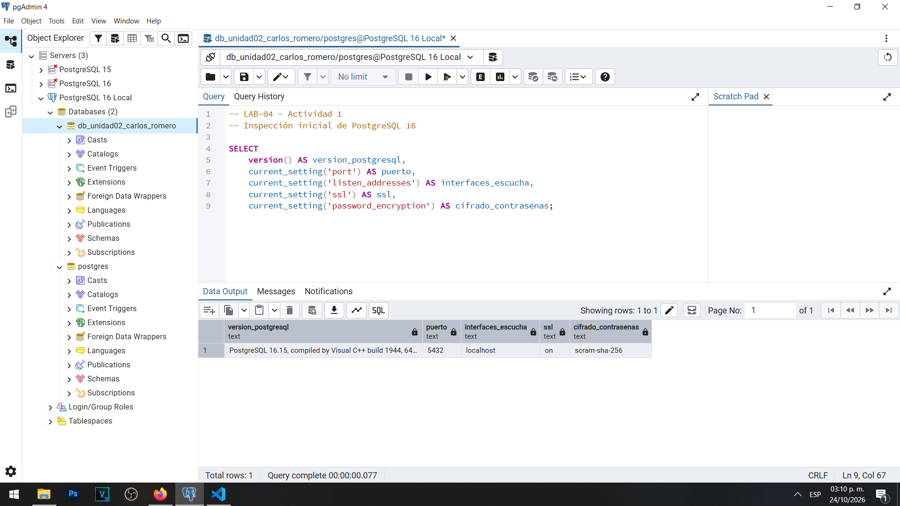
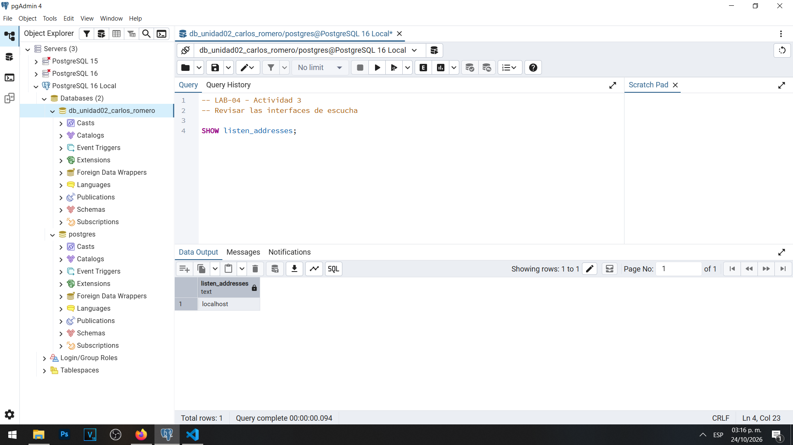
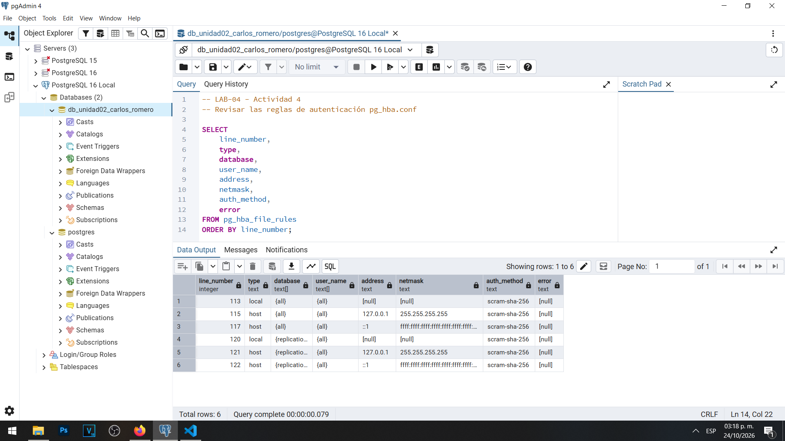
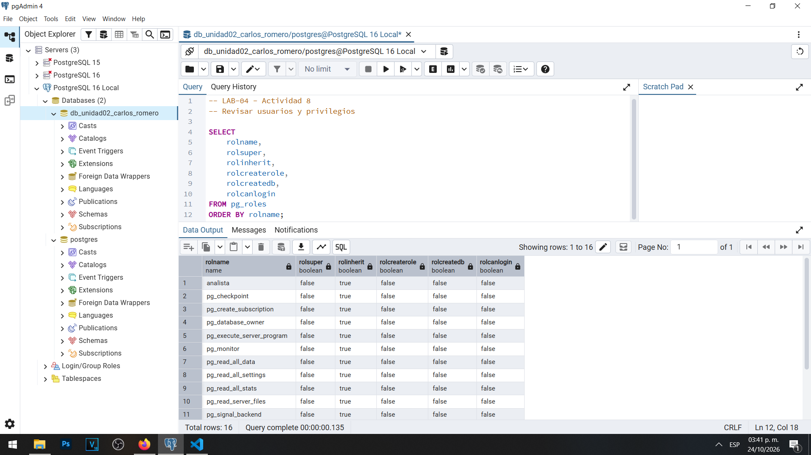
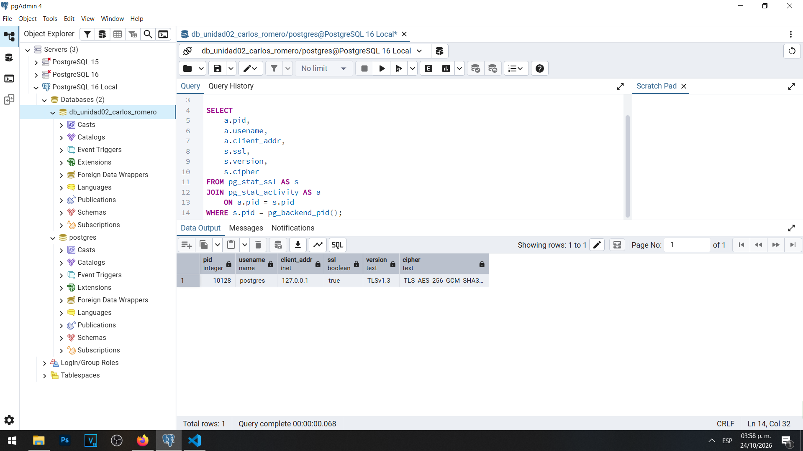
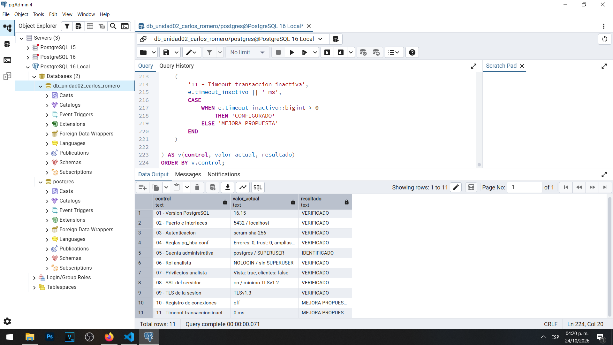

# LAB-04 — Hardening y configuración segura de PostgreSQL

**Materia:** Gestión de Seguridad y Desempeño de Bases de Datos  
**Unidad:** II — Seguridad, privacidad y control de acceso  
**Tema:** Hardening de servidores de bases de datos  
**Estudiante:** Carlos Romero  
**Motor:** PostgreSQL 16.15  
**Sistema operativo:** Windows  
**Herramientas:** pgAdmin 4, PowerShell y Visual Studio Code  
**Base de datos:** `db_unidad02_carlos_romero`

---

## 1. Objetivo

Evaluar la configuración de seguridad de un servidor PostgreSQL 16, identificando su superficie de ataque, revisando los mecanismos de autenticación y autorización, analizando los permisos del sistema operativo y comprobando la protección de las conexiones mediante TLS.

El laboratorio también tiene como finalidad elaborar una línea base de seguridad, documentar riesgos y proponer controles de hardening basados en el principio de mínimo privilegio.

Las actividades se desarrollaron en un entorno académico local, evitando modificaciones innecesarias que pudieran afectar el funcionamiento del servidor o los laboratorios anteriores.

## 2. Entorno

Las prácticas se realizaron utilizando una instalación local de PostgreSQL 16.15 en Windows, administrada mediante pgAdmin 4.

| Elemento | Configuración |
|---|---|
| Motor de base de datos | PostgreSQL 16.15 |
| Servidor | PostgreSQL 16 Local |
| Base de datos | `db_unidad02_carlos_romero` |
| Servicio de Windows | `postgresql-x64-16` |
| Cuenta del servicio | `NT AUTHORITY\NetworkService` |
| Puerto | 5432 |
| Interfaces de escucha | `localhost` |
| Método de contraseñas configurado | `scram-sha-256` |
| SSL | Habilitado |
| TLS mínimo | TLS 1.2 |
| TLS negociado en la conexión verificada | TLS 1.3 |

El servidor ya había sido utilizado durante los laboratorios anteriores de la Unidad II.

Durante el LAB-02 se configuraron mecanismos de cifrado y comunicaciones seguras, mientras que en el LAB-03 se implementaron controles de minimización y restricción de permisos.

Estos antecedentes permitieron desarrollar el LAB-04 sobre un entorno funcional que ya incorporaba diferentes medidas de seguridad.

## 3. Superficie de ataque inicial

### 3.1 Inspección del servidor

Se ejecutaron consultas SQL para identificar la versión de PostgreSQL, el puerto, las interfaces de escucha, la configuración SSL y el mecanismo de almacenamiento de nuevas contraseñas.

Los resultados confirmaron que PostgreSQL utilizaba el puerto 5432, escuchaba en `localhost`, tenía SSL habilitado y mantenía configurado SCRAM-SHA-256.

**Evidencia 01 — Superficie de ataque inicial**



También se consultó `pg_stat_activity` para identificar las conexiones activas.

Durante la inspección se observaron conexiones de pgAdmin mediante la dirección local `127.0.0.1`, además de procesos internos del servidor.

[Evidencia adicional — Conexiones actuales](evidencias/01b-conexiones-actuales.png)

### 3.2 Archivos de configuración

Se identificaron los principales archivos de PostgreSQL:

| Archivo | Función |
|---|---|
| `postgresql.conf` | Configuración general del servidor |
| `pg_hba.conf` | Reglas de autenticación y conexiones |
| `pg_ident.conf` | Correspondencias de identidades |

Los archivos se encuentran en el directorio de datos de la instalación local de PostgreSQL 16.

También se revisaron los directorios y parámetros de registro de eventos.

[Archivos de configuración](evidencias/02-archivos-configuracion.png)

[Directorios y registros](evidencias/02b-directorios-logs.png)

### 3.3 Interfaces de escucha

Se ejecutó la instrucción:

```sql
SHOW listen_addresses;
```

El resultado fue `localhost`.

**Evidencia 02 — Interfaces de escucha**



Esto significa que PostgreSQL está configurado para escuchar mediante las interfaces locales.

Para nuestro entorno académico, esta restricción resulta adecuada porque no necesitamos conexiones desde otros equipos.

## 4. Hallazgos

### 4.1 Reglas de autenticación

Mediante la vista `pg_hba_file_rules` se examinaron las reglas de autenticación configuradas.

Se encontraron seis reglas correspondientes a conexiones locales y replicación.

Todas utilizaban el método `scram-sha-256`.

No se identificaron reglas con autenticación `trust`, orígenes abiertos a cualquier dirección IPv4 o IPv6 ni errores de análisis.

**Evidencia 03 — Reglas de pg_hba.conf**



Estas reglas ya proporcionaban una restricción apropiada para nuestro entorno local, por lo que no fue necesario modificarlas.

### 4.2 Autenticación SCRAM-SHA-256

Se comprobó el parámetro:

```sql
SHOW password_encryption;
```

El resultado fue `scram-sha-256`.

Este valor indica el mecanismo configurado para almacenar nuevas contraseñas.

La comprobación no permite afirmar, por sí sola, que todos los verificadores de contraseñas creados anteriormente utilicen SCRAM.

[Evidencia adicional — Autenticación](evidencias/03b-autenticacion.png)

### 4.3 Usuarios y privilegios

Se consultaron los roles disponibles mediante `pg_roles`.

Se identificaron 16 roles, de los cuales 14 eran roles predefinidos de PostgreSQL.

Los dos roles no predefinidos eran:

| Rol | LOGIN | SUPERUSER | CREATEROLE | CREATEDB |
|---|---|---|---|---|
| `postgres` | Sí | Sí | Sí | Sí |
| `analista` | No | No | No | No |

La cuenta `postgres` dispone de privilegios administrativos, mientras que `analista` fue creado durante el LAB-03 para representar permisos limitados.

**Evidencia 04 — Roles y privilegios**



[Consulta adicional — Roles del laboratorio](evidencias/04b-roles-laboratorio.png)

También se comprobó anteriormente que el rol `analista` puede consultar `v_analitica_clientes`, pero no dispone de acceso directo a la tabla `clientes`.

Este resultado demuestra la aplicación de restricciones por finalidad y del principio de mínimo privilegio.

### 4.4 Extensiones instaladas

Se ejecutó una consulta sobre `pg_extension`.

Se identificaron las siguientes extensiones:

| Extensión | Versión | Función |
|---|---|---|
| `pgcrypto` | 1.3 | Funciones criptográficas |
| `plpgsql` | 1.0 | Funciones y procedimientos |

La extensión `pgcrypto` fue utilizada durante el LAB-02 para realizar pruebas de cifrado.

No se eliminaron extensiones, debido a que no se identificó una necesidad justificada para hacerlo.

[Evidencia adicional — Extensiones](evidencias/04c-extensiones.png)

### 4.5 Límites de conexiones y tiempos de espera

Se revisaron los siguientes parámetros:

| Parámetro | Valor |
|---|---|
| `max_connections` | 100 |
| `superuser_reserved_connections` | 3 |
| `statement_timeout` | 0 ms |
| `idle_in_transaction_session_timeout` | 0 ms |

Los valores de cero indican que los límites generales correspondientes están desactivados.

Esta situación representa una oportunidad de mejora, especialmente en sistemas productivos donde existen aplicaciones con numerosas conexiones o transacciones.

[Evidencia adicional — Conexiones y tiempos de espera](evidencias/04d-conexiones-timeouts.png)

### 4.6 Registros de conexiones

Durante la revisión inicial se encontraron los siguientes valores:

| Parámetro | Valor |
|---|---|
| `logging_collector` | `on` |
| `log_connections` | `off` |
| `log_disconnections` | `off` |
| `log_destination` | `stderr` |
| `log_directory` | `log` |

Aunque el recolector de registros está habilitado, no se encuentran activados los registros específicos de conexiones y desconexiones.

Se recomienda evaluar su activación conforme a las necesidades de auditoría de la organización.

### 4.7 Permisos del sistema operativo

Mediante Windows PowerShell se revisaron los permisos NTFS de `postgresql.conf`, `pg_hba.conf` y el directorio de datos.

Se identificó que el servicio se ejecuta mediante `NT AUTHORITY\NetworkService`.

También se observaron permisos de control total correspondientes a administradores, SYSTEM y la cuenta local utilizada para administrar el equipo.

No se identificó en las capturas un permiso general para todos los usuarios.

Sin embargo, es conveniente revisar periódicamente las ACL para justificar los accesos existentes.

[Permisos de los archivos](evidencias/04e-permisos-archivos.png)

[Permisos del directorio de datos](evidencias/04f-permisos-directorio.png)

Durante esta actividad no se modificaron permisos de Windows.

### 4.8 Exposición de red

Mediante PowerShell se inspeccionaron las conexiones TCP asociadas al puerto 5432.

Los resultados mostraron que el proceso `postgres` escuchaba en:

- `127.0.0.1`
- `::1`

Se identificó el PID 4268 durante la captura. Este identificador corresponde al proceso observado en ese momento y puede variar cuando el servicio se reinicia.

También se ejecutó una prueba de conectividad hacia `127.0.0.1:5432`.

El resultado fue:

`TcpTestSucceeded : True`

[Exposición de red](evidencias/04g-exposicion-red.png)

[Conectividad local](evidencias/04h-conectividad-local.png)

Estas pruebas confirmaron el funcionamiento local del servidor y no mostraron sockets de escucha de PostgreSQL en interfaces externas para el puerto revisado.

### 4.9 Protección TLS

Se comprobó que PostgreSQL tiene SSL habilitado y permite como mínimo TLS 1.2.

Además, se consultó `pg_stat_ssl` para verificar la conexión actual de pgAdmin.

Los resultados confirmaron que la conexión estaba cifrada y utilizaba TLS 1.3.

**Evidencia 05 — Verificación de TLS**



[Configuración adicional de SSL/TLS](evidencias/05a-configuracion-tls.png)

Esta verificación demuestra que la sesión examinada utilizó TLS, pero no garantiza que todos los clientes estén obligados a utilizar cifrado ni que validen correctamente el certificado del servidor.

## 5. Cambios realizados

### 5.1 Estado inicial y final

Durante el LAB-04 se priorizó la inspección y verificación de controles existentes.

Debido a que varios parámetros ya estaban configurados de manera adecuada para el entorno local, no fue necesario realizar modificaciones a la configuración activa del servidor.

| Control | Antes | Después |
|---|---|---|
| Interfaces | `localhost` | Sin cambios |
| Puerto | `5432` | Sin cambios |
| Autenticación | SCRAM-SHA-256 | Sin cambios |
| Reglas pg_hba.conf | Acceso local | Sin cambios |
| Cuentas existentes | `postgres`, `analista` | Sin cambios |
| SSL | `on` | Sin cambios |
| TLS mínimo | TLS 1.2 | Sin cambios |
| Extensiones | `pgcrypto`, `plpgsql` | Sin cambios |
| Tiempos de espera | Valores generales en cero | Sin cambios |
| Permisos NTFS | Permisos inspeccionados | Sin cambios |

La matriz detallada se encuentra en [configuracion/cambios.md](configuracion/cambios.md).

### 5.2 Propuestas elaboradas

Durante las actividades se diseñaron medidas de fortalecimiento relacionadas con:

- Reglas de autenticación más específicas por usuario, base de datos y origen.
- Separación entre cuentas DBA, aplicación y consulta.
- Política de firewall con redes autorizadas.
- Revisión de permisos NTFS.
- Activación de registros de eventos cuando corresponda.
- Definición de límites de tiempo apropiados.
- Validación de certificados TLS.
- Actualizaciones y revisiones periódicas.

Estas medidas fueron documentadas como propuestas académicas, no como configuraciones implementadas.

No se modificaron `postgresql.conf`, `pg_hba.conf`, el firewall de Windows, los certificados, las cuentas existentes ni las ACL durante el LAB-04.

## 6. Justificación de los cambios y decisiones

### 6.1 Restricción de interfaces

Mantener `listen_addresses = 'localhost'` reduce la exposición innecesaria del servicio para nuestro escenario, debido a que las prácticas solamente necesitan conexiones locales.

No se justificaba ampliar la escucha hacia otras interfaces.

### 6.2 Reglas de autenticación

Las reglas actuales de `pg_hba.conf` ya restringen los orígenes a direcciones locales y requieren SCRAM-SHA-256.

Aunque se diseñaron reglas conceptuales más específicas, implementarlas requiere comprobar sus dependencias y preservar el acceso administrativo.

### 6.3 Separación de cuentas

Se identificó que `postgres` conserva privilegios administrativos.

Se propuso separar las cuentas de administración, aplicación y consulta, para evitar que una aplicación ordinaria utilice privilegios excesivos.

### 6.4 Protección del sistema operativo

Los permisos NTFS protegen los archivos de configuración y el directorio de datos.

No se realizaron cambios en las ACL porque primero es necesario comprobar las dependencias del servicio y de los certificados TLS.

### 6.5 Auditoría y disponibilidad

Se identificaron oportunidades de mejora relacionadas con los registros de conexiones y los tiempos de espera.

Estos parámetros deberán evaluarse según las necesidades y características de las aplicaciones antes de modificarse.

### 6.6 Comunicaciones cifradas

La conexión de pgAdmin ya utilizaba TLS 1.3.

No se modificaron los certificados ni las opciones SSL, ya que el objetivo inmediato fue verificar el estado existente.

Se recomendó comprobar adicionalmente la validación de certificados y los requisitos de TLS para otras conexiones.

## 7. Verificación

Para comprobar los controles principales se preparó el archivo [04-verificacion.sql](sql/04-verificacion.sql).

El script reúne verificaciones relacionadas con:

- Versión de PostgreSQL.
- Puerto e interfaces.
- Autenticación SCRAM-SHA-256.
- Reglas de `pg_hba.conf`.
- Cuenta administrativa.
- Rol `analista`.
- Privilegios de consulta.
- SSL.
- TLS de la sesión.
- Registro de conexiones.
- Tiempo de espera de transacciones inactivas.

### Resultado final

La consulta produjo once resultados:

| Estado | Cantidad |
|---|---:|
| `VERIFICADO` | 8 |
| `IDENTIFICADO` | 1 |
| `MEJORA PROPUESTA` | 2 |
| **Total** | **11** |

**Evidencia 06 — Verificación final del hardening**



Los ocho controles verificados coincidieron con los valores esperados para nuestro entorno local.

La cuenta `postgres` fue identificada como administrativa.

Las dos mejoras propuestas corresponden a los registros de conexiones y al tiempo de espera de transacciones inactivas.

No aparecieron controles con estado `REVISAR`.

La verificación se ejecutó correctamente y no modificó la configuración del servidor.

## 8. Checklist de hardening

Durante la Actividad 17 se elaboró un checklist con 18 controles de seguridad.

### Resumen del checklist

| N.º | Control | Estado |
|---|---|---|
| 1 | Puerto documentado | Sí |
| 2 | Interfaces justificadas | Sí |
| 3 | Reglas pg_hba.conf revisadas | Sí |
| 4 | Redes autorizadas restringidas | Sí |
| 5 | Autenticación SCRAM configurada | Sí |
| 6 | Superusuarios identificados | Sí |
| 7 | Cuentas de aplicación separadas | No |
| 8 | Mínimo privilegio | Parcial |
| 9 | Extensiones revisadas | Sí |
| 10 | TLS verificado en la sesión | Sí |
| 11 | Archivos de configuración protegidos | Parcial |
| 12 | Directorio de datos protegido | Parcial |
| 13 | Política de firewall documentada | Sí, diseño conceptual |
| 14 | Política de actualizaciones | Parcial |
| 15 | Configuración de seguridad documentada | Sí |
| 16 | Registros de conexiones evaluados | Parcial |
| 17 | Tiempos de espera revisados | Parcial |
| 18 | Validación del certificado por el cliente | No comprobada |

El checklist demuestra que la configuración presenta diferentes niveles de cumplimiento.

La revisión de un control no implica necesariamente que todos sus mecanismos hayan sido implementados o que sean suficientes para cualquier entorno productivo.

El checklist completo, con evidencias y justificaciones, se encuentra en [configuracion/baseline.md](configuracion/baseline.md).

## 9. Desarrollo de las 19 actividades

| Actividad | Trabajo realizado | Evidencia |
|---|---|---|
| 1. Superficie de ataque | Inspección de versión, puerto, SSL y conexiones | Captura 01 |
| 2. Archivos de configuración | Identificación de rutas y registros | Capturas 02 adicionales |
| 3. Interfaces de escucha | Verificación de `listen_addresses` | Captura 02 |
| 4. Reglas pg_hba.conf | Inspección de reglas y autenticación | Captura 03 |
| 5. Regla permisiva | Análisis de `0.0.0.0/0` | `baseline.md` |
| 6. Mínimo privilegio en conexiones | Diseño de regla restringida | `baseline.md` |
| 7. Autenticación | Verificación de SCRAM-SHA-256 | Captura 03b |
| 8. Roles y privilegios | Inspección de cuentas administrativas | Captura 04 |
| 9. Separación de cuentas | Diseño DBA, APP y CONSULTA | `baseline.md` |
| 10. Extensiones | Revisión de pgcrypto y plpgsql | Captura 04c |
| 11. Conexiones y timeouts | Inspección de límites y tiempos de espera | Captura 04d |
| 12. Permisos del sistema operativo | Revisión de ACL de Windows | Capturas 04e y 04f |
| 13. Exposición de red | Comprobación con PowerShell | Capturas 04g y 04h |
| 14. Política de firewall | Diseño de reglas restrictivas | `cambios.md` |
| 15. TLS | Verificación del cifrado de sesión | Captura 05 |
| 16. Comparación | Matriz antes y después | `cambios.md` |
| 17. Checklist | Evaluación de 18 controles | `baseline.md` |
| 18. Caso integral | Análisis de 12 riesgos y medidas correctivas | `cambios.md` |
| 19. Línea base | Propuesta de siete áreas de seguridad | `baseline.md` |

Las actividades se desarrollaron mediante consultas, verificaciones técnicas y análisis conceptuales.

## 10. Archivos del laboratorio

### Scripts SQL

| Archivo | Contenido |
|---|---|
| [01-inspeccion.sql](sql/01-inspeccion.sql) | Configuración inicial, conexiones, rutas y superficie de ataque |
| [02-roles.sql](sql/02-roles.sql) | Roles, privilegios y mínimo privilegio |
| [03-configuracion.sql](sql/03-configuracion.sql) | Autenticación, extensiones, conexiones, registros y TLS |
| [04-verificacion.sql](sql/04-verificacion.sql) | Verificación final de los principales controles |

Los cuatro scripts están diseñados para consultar información sin modificar datos ni configuraciones.

### Documentación de configuración

| Documento | Contenido |
|---|---|
| [baseline.md](configuracion/baseline.md) | Línea base, análisis de reglas, separación de cuentas y checklist |
| [cambios.md](configuracion/cambios.md) | Firewall, comparación inicial/final y evaluación integral |

### Informe

El informe incluye los resultados de la inspección, diez preguntas técnicas con sus respuestas, una reflexión individual y las conclusiones.

[Consultar informe completo del LAB-04](informe.md)

### Evidencias de pgAdmin y PowerShell

Las capturas se encuentran en la carpeta [evidencias](evidencias/).

Las seis principales son:

- [01 — Superficie de ataque](evidencias/01-superficie-ataque.png)
- [02 — Interfaces de escucha](evidencias/02-listen-addresses.png)
- [03 — Reglas de autenticación](evidencias/03-pg-hba.png)
- [04 — Roles y privilegios](evidencias/04-roles.png)
- [05 — TLS](evidencias/05-tls.png)
- [06 — Verificación final](evidencias/06-verificacion.png)

También se conservaron capturas adicionales de archivos de configuración, registros, autenticación, extensiones, conexiones, ACL de Windows y exposición de red.

## 11. Relación con los laboratorios anteriores

El LAB-04 complementa los conocimientos desarrollados durante la Unidad II.

**LAB-01 — Protección y privacidad:** clasificación, permisos y protección de información.

**LAB-02 — Cifrado y comunicaciones seguras:** protección criptográfica de datos, autenticación y conexiones TLS.

**LAB-03 — Privacidad y cumplimiento:** minimización, limitación de finalidades, derechos ARCO y gobierno de datos.

**LAB-04 — Hardening:** inspección del servidor, reducción de la superficie de ataque, revisión de configuraciones y construcción de una línea base de seguridad.

La integración de estos temas permite comprender que la seguridad de una base de datos requiere proteger tanto la información como el entorno tecnológico que permite utilizarla.

## 12. Conclusiones

El LAB-04 permitió analizar de manera integral las principales configuraciones de seguridad de PostgreSQL 16.

Se comprobaron controles existentes como la restricción de interfaces locales, autenticación SCRAM-SHA-256, roles diferenciados y una conexión cifrada mediante TLS 1.3.

También se identificaron oportunidades de mejora relacionadas con la auditoría de conexiones, la administración de tiempos de espera, la separación de cuentas y la protección de archivos del sistema operativo.

Las actividades demostraron que un servidor no debe considerarse seguro únicamente por utilizar una contraseña fuerte o por cambiar su número de puerto.

El hardening requiere combinar medidas de red, autenticación, autorización, sistema operativo, cifrado, configuración y mantenimiento.

En nuestro entorno se decidió conservar los parámetros que ya eran apropiados para las prácticas y documentar por separado las recomendaciones que requerirían una evaluación posterior.

Finalmente, se construyó una línea base de seguridad y un checklist de 18 controles que podrán utilizarse como referencia en futuras revisiones.

**La principal conclusión es que un proceso de hardening debe permitir identificar riesgos, justificar controles y verificar resultados sin comprometer innecesariamente la disponibilidad del sistema.**
